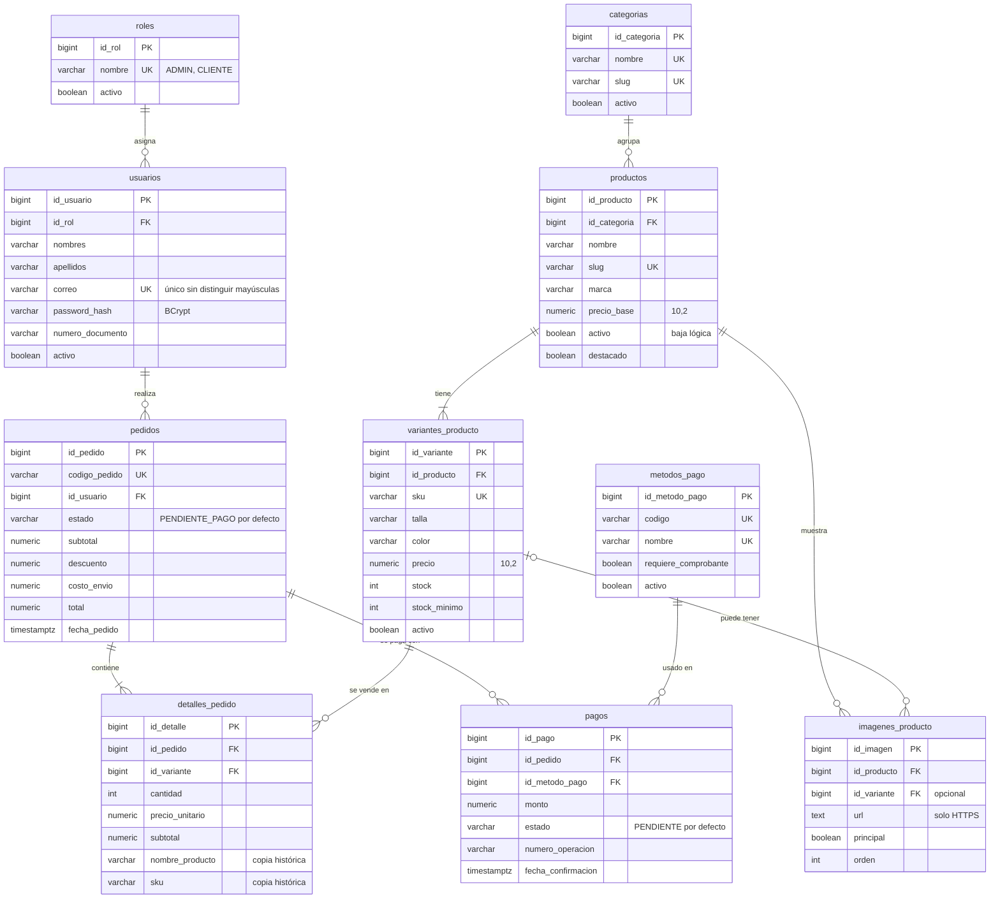

# Modelo de datos de Monarca

Base de datos PostgreSQL en Supabase, esquema `monarca`. Tiene 10 tablas, y cada
una corresponde a una entidad JPA de `backend/src/main/java/com/Monarca/Backend/model`.
El backend arranca con `ddl-auto=validate`: **no crea ni modifica tablas**, solo
comprueba que el esquema coincida con las entidades.

## Diagrama entidad-relación

GitHub dibuja este diagrama automáticamente (Mermaid).

## Tablas

| Tabla | Para qué sirve | Relaciones |
| --- | --- | --- |
| `roles` | Tipos de usuario (administrador, cliente). | 1 rol → muchos usuarios |
| `usuarios` | Cuentas registradas. La contraseña se guarda cifrada (`password_hash`). | Pertenece a un rol; realiza pedidos |
| `categorias` | Tops, Bottoms, Calzado, Accesorios. | 1 categoría → muchos productos |
| `productos` | Datos comunes del artículo: nombre, marca, descripción, precio base. | Tiene variantes e imágenes |
| `variantes_producto` | Combinación concreta talla + color, con su SKU, precio y **stock**. Es lo que realmente se compra. | Única por (producto, talla, color) |
| `imagenes_producto` | Fotos del producto. La principal (`principal = true`) se muestra en el catálogo. | Puede ligarse a una variante (p. ej. foto del color negro) |
| `pedidos` | Cabecera de la compra: cliente, estado y montos. | 1 pedido → muchos detalles y pagos |
| `detalles_pedido` | Cada línea del pedido. Copia nombre, SKU, talla, color y precio del momento de la compra. | Apunta a la variante vendida |
| `metodos_pago` | Catálogo de medios de pago (Yape, Plin, transferencia…). | Usado por los pagos |
| `pagos` | Registro del pago de un pedido y su comprobación manual por el administrador. | Pertenece a un pedido y a un método |

## Decisiones de diseño

- **Producto y variante separados.** El stock y el precio final viven en
  `variantes_producto`, porque una misma prenda puede tener stock distinto por
  talla o color. El carrito y los pedidos trabajan siempre con `id_variante`.
- **Copia histórica en `detalles_pedido`.** Si luego se cambia el nombre o el
  precio de un producto, los pedidos anteriores conservan lo que realmente se vendió.
- **Baja lógica.** Eliminar un producto solo pone `activo = false`, así no se
  rompen los pedidos que lo referencian.
- **Montos con `numeric(10,2)`** (BigDecimal en Java) para evitar errores de
  redondeo con dinero.
- **Estados controlados con CHECK.** Los estados de `pedidos` y `pagos` están
  restringidos en la base. Las transiciones permitidas se explican en
  [PEDIDOS.md](../../PEDIDOS.md).

## Archivos relacionados

- [README.md](README.md): consultas de diagnóstico del esquema y evidencia revisada en Supabase.
- `01_diagnostico_columnas.sql`, `02_restricciones.sql`, `03_indices.sql`: consultas de solo lectura.
- `evidencias/`: resultados exportados de restricciones e índices.
